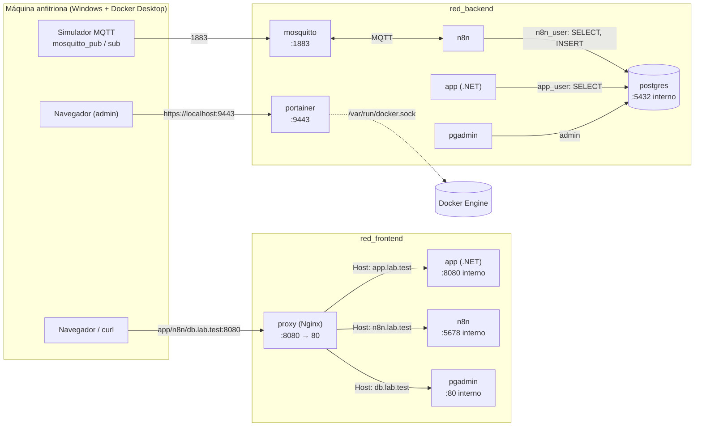

# Diagrama de arquitectura

`app`, `n8n` y `pgadmin` están conectados a ambas redes (el recuadro los dibuja en cada una según el rol que cumplen en ella). `postgres`, `mosquitto` y `portainer` solo están en `red_backend`.

## Puertos publicados en el host

| Servicio | Puerto host | Observación |
|---|---|---|
| proxy (Nginx) | 8080 | Único punto de entrada HTTP |
| mosquitto | 1883 | Pruebas MQTT desde el host |
| portainer | 127.0.0.1:9443 | Solo accesible desde la propia máquina |

PostgreSQL, la aplicación web, n8n y pgAdmin no publican puertos.

## Redes

- `red_frontend`: proxy, app, n8n, pgadmin. Es la red por la que el proxy alcanza a los servicios web.
- `red_backend`: postgres, mosquitto, portainer y los servicios que los consumen (app, n8n, pgadmin). La base de datos y el broker no son alcanzables desde el proxy.

## Volúmenes

`postgres_datos`, `pgadmin_datos`, `n8n_datos`, `mosquitto_datos`, `portainer_datos`.
